# Slop Dungeon



A Claude Code skill that runs a code review as an old-school text adventure.

The ticket's intent is the quest. Four fast agents scout the diff, one per wing of the
dungeon: Intent, Architecture, Blast radius, and Side-effects with Risks. Each real
finding is a monster. You fight it (apply a fix), parley (argue it is fine), flee (defer
it) or move on. A dungeon master guides you through the dungeon by the ticket's intent.
The findings are real.

## Install

Copy or symlink this folder into `~/.claude/skills/slop-dungeon`, then run:

```
/slop-dungeon TICKET-123
/slop-dungeon my-branch main
```

## License

MIT
